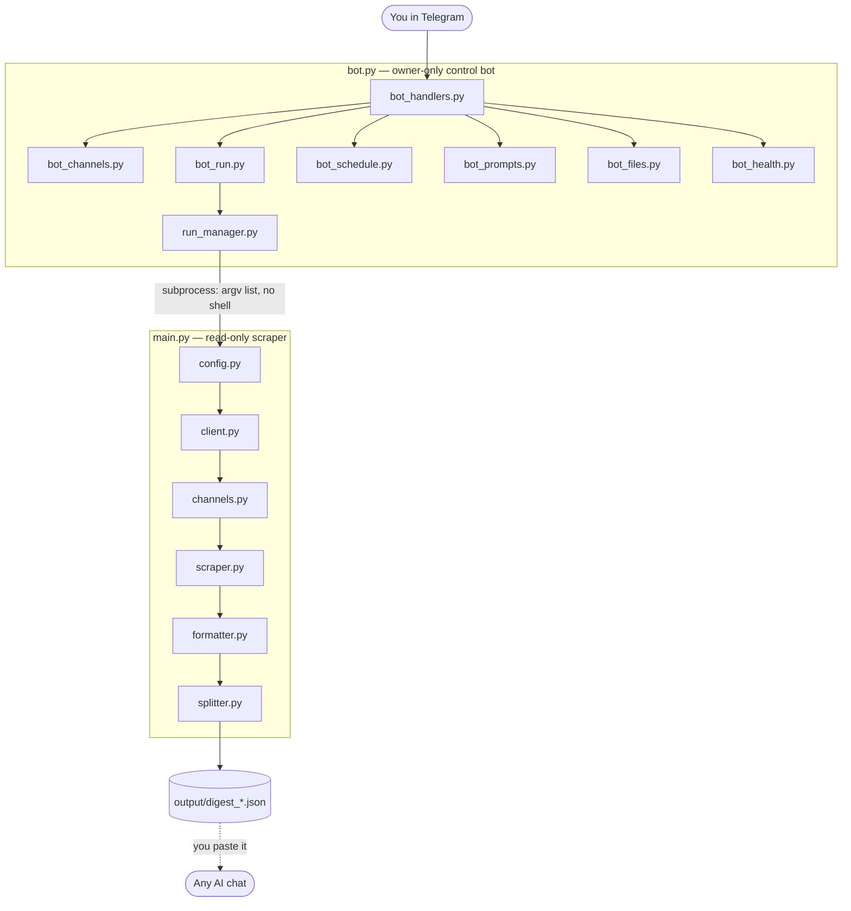

# tg-digest-userbot

[](https://pavnxet.github.io/tg-digest-userbot/)
[](https://github.com/pavnxet/tg-digest-userbot/actions/workflows/ci.yml)
[](https://www.python.org/)
[](https://github.com/LonamiWebs/Telethon)
[](https://pavnxet.github.io/tg-digest-userbot/)
[](https://pavnxet.github.io/tg-digest-userbot/#s13)

> **📖 New here?** The **[full command guide](https://pavnxet.github.io/tg-digest-userbot/)** walks through
> every bot command with examples — channels, runs, schedules, prompts, files and health.

A **read-only** Telegram *user bot* that reads the text of the channels **you**
choose, for a time window **you** choose, and writes it to one structured JSON
file you can paste into any AI (ChatGPT, Claude, Gemini…) for a summary.

It is a personal, local tool. It never sends anything, never reacts, never marks
messages as read, and never uploads or stores anything outside your machine.
A separate **owner-only control bot** lets you drive it from your own Telegram
chat: add channels, run a digest, schedule it, and search past outputs.

---

## Why a "user bot" (MTProto) and not a Bot API bot?

The Bot API can only see channels a *bot* was added to, and it cannot read
history. To read your own subscriptions, the digest has to run as **you** —
which is what Telethon's MTProto user client does. That is also why the code is
deliberately conservative about joining and rate limits: it is your real account.

---

## 1. Install

```bash
git clone https://github.com/pavnxet/tg-digest-userbot.git
cd tg-digest-userbot

python -m venv .venv
source .venv/bin/activate        # Windows: .venv\Scripts\activate

pip install -r requirements.txt
```

Requires **Python 3.10+**.

---

## 2. Get `API_ID` and `API_HASH`

1. Go to **https://my.telegram.org** and log in with your phone number.
2. Open **API development tools**.
3. Fill the short form (App title and Short name can be anything, e.g.
   `tg-digest`).
4. Copy the **api_id** (a number) and **api_hash** (a long hex string).

Then set up your environment file:

```bash
cp .env.example .env
```

Edit `.env`:

```
API_ID=1234567
API_HASH=0123456789abcdef0123456789abcdef
PHONE=+919XXXXXXXXX
```

`.env`, `*.session`, `output/` and `.cache/` are all in `.gitignore` — your
secrets never get committed.

---

## 3. First-time login

Login is now normally done **from a chat with your own control bot** (section 3b),
so the OTP/2FA never has to be typed in a terminal. If no valid session exists,
`main.py` prints a clear message instead of prompting:

```
Not logged in. Start `python bot.py` and send /login to the bot, or run with --terminal-login.
```

The old terminal login is still available behind a flag:

```bash
python main.py --today --terminal-login
```

You will be asked, in the terminal, for:

1. the **login code** Telegram sends you in-app, and
2. your **two-factor (2FA) password**, *only if* you have 2FA enabled.

After that, later runs are silent.

---

## 3b. Control bot: log in, check status, log out from chat

A small bot (created via @BotFather) through which you can log your account in,
check `/status`, and `/logout` — all from a private chat. It is **owner-only**:
everyone else is silently ignored.

### Create the bot

1. Open Telegram, talk to **@BotFather**, send `/newbot`, and follow the prompts.
2. BotFather replies with a **token** like `123456789:AA...`. Put it in `.env`:

   ```
   BOT_TOKEN=123456789:AA...
   ```
3. Start it:

   ```bash
   python bot.py
   ```

### Pairing (first run)

Set `OWNER_ID` in `.env` to your numeric Telegram user id, **or** leave it blank
to pair on first run. With pairing, `bot.py` prints a random code in the
**terminal only**:

```
Pairing code (terminal only): 3f9a1c2b
Send  /claim <code>  to your bot in a private chat.
```

Send `/claim 3f9a1c2b` to the bot from your own account. The first user to do so
becomes the owner; the code is then dead forever. The code is never shown in the
chat.

### Commands

| Command | What it does |
|---|---|
| `/start`, `/help` | Short usage |
| `/login` | **QR login** (default). Scans a QR from a second device's Telegram (Settings > Devices > Link Desktop Device). The QR is refreshed up to 3 times, ~2–3 minutes. |
| `/login_phone` | Phone + code login (fallback). See the warning below. |
| `/status` | Logged in? Shows the first name and only the **last 2 digits** of the phone. |
| `/logout` | Confirms with a button, then logs out on Telegram's side and deletes the local session file. |
| `/cancel` | Aborts any in-progress login and clears all state. |

**Which method?** Use `/login` (QR) whenever you have a second device or screen —
it never puts the login code through the chat. Use `/login_phone` only if you
cannot scan a QR, and expect that Telegram **may reject a code sent through a
chat**; if that happens the bot will tell you and point you back to QR or the
terminal.

### Security (short version)

- The bot chat is **not** end-to-end encrypted; anything you type is stored on
  Telegram's servers until deleted. The bot deletes your phone/code/password
  messages immediately, but deletion is best-effort.
- **For the 2FA password, the terminal is safest** (`python main.py
  --terminal-login`) — nothing goes through a chat.
- Only your numeric user id is served; non-owner messages get no reply.
- Full threat model and the secrets inventory: [`docs/SECURITY.md`](docs/SECURITY.md).

### Troubleshooting

| Symptom | Fix |
|---|---|
| `database is locked` when the bot reports status | A scraper run is using `tg_digest.session`. Wait for it to finish; the bot retries cleanly. |
| QR will not scan | Make sure the QR is being opened from a **second device's** Telegram (Settings > Devices > Link Desktop Device), and that you scan while the bot is still waiting. Try `/login` again. |
| Code rejected right after typing | Telegram may block codes sent through chat. Use `/login` (QR) or `--terminal-login`. |
| `/claim` does nothing | Wrong code, or the code was already used. Restart `bot.py` to print a fresh code (only if not yet paired). |

---

## 3c. Full command reference

Everything below is owner-only, private-chat only. Non-owner messages get no reply.

### Account
| Command | What it does |
|---|---|
| `/start`, `/help` | Short usage |
| `/login` | QR login (default). Refresh up to 3 times, ~2-3 min. |
| `/login_phone` | Phone + code fallback (Telegram may reject a chat-typed code). |
| `/status` | Logged in? First name + last 2 phone digits only. |
| `/logout` | Confirms, then logs out and deletes the local session file. |
| `/cancel` | Aborts an in-progress login and clears state. |

### Channels
| Command | What it does |
|---|---|
| `/channels [tag\|paused\|invalid]` | List channels (20 per page) with paused/invalid marks; `paused` and `invalid` are filters. Unnamed channels show their resolved title once known. |
| `/add <link\|@name\|id> [\| label]` | Validate (read-only) and append. Shows title + membership. |
| `/remove <#\|link\|name>` | Remove, after confirmation. Ambiguous matches ask which. |
| `/pause <#>` / `/resume <#>` | Mark a line `off` / remove the mark. |
| `/tag <#> <tag>` / `/untag <#> <tag>` | Add / remove a tag. |
| `/groups` | List tag groups with counts. |

`channels.txt` line syntax (old lines keep working):

```
# comment — ignored
@news | Daily News | tags=news,jobs | off
https://t.me/somechannel | Some Channel
-1001234567890
```

Segments after the entry: anything is a label, `tags=a,b` sets tags, `off` pauses
the line (the scraper skips it and reports it as `paused`).

### Running
| Command | What it does |
|---|---|
| `/run <window> [group:<tag>] [channel:<n>] [dedupe] [min:<N>] [views] [send:no] [resume]` | Run the scraper. Window: `today`, `yesterday`, `6h`, `24h`, `3d`, `since-last`, `all`, or `YYYY-MM-DD HH:MM YYYY-MM-DD HH:MM` (IST). |
| `/history <#\|@name\|link> [dedupe] [min:<N>] [views] [send:yes]` | Scrape one channel's **entire history**. Long-running; the file is not sent unless you add `send:yes`. |
| `/stop` | Kill the whole run process tree. |
| `/preview <window> [group:<tag>]` | Dry-run; shows message counts per channel. No file. |
| `/last` | Resend the most recent digest. |

The window can go **anywhere** in the line, so `/run 3d channel:5` and
`/run channel:5 3d` both work.

If a run is stopped, times out or fails, the summary carries a **🔁 Resume**
button that continues it from its checkpoint with the same options.

Limits (to protect the account): one run at a time, minimum 5 minutes between
runs, maximum 12 runs per day (manual and scheduled share these), 30-minute hard
timeout. Files are sent as documents; more than 10 parts asks first.

#### Full history (`all` / `/history`)

`/run all [group:<tag>] [channel:<n>]` — or the friendlier `/history 3`, which
accepts a `/channels` number, an `@name` or a link — reads a channel from its
**first message** to now:

- the per-channel message cap is lifted (it would otherwise stop at 5,000);
- the run gets a **2-hour** timeout instead of 30 minutes, and tolerates much
  longer FloodWaits, because it can take a long time;
- the digest is **not** sent to the chat unless you ask (`send:yes`), since a
  full history can be very large;
- progress and `/stop` work exactly as for a normal run;
- if it is interrupted, what was read so far is kept in the checkpoint. Re-send
  the same command with `resume` at the end to continue from where it stopped.

From the command line:

```bash
python main.py --all-history --channels-file one_channel.txt
```

### Schedules (IST, max 5)
`/schedule add <HH:MM> <window> [group:<tag>]`, `/schedule list`,
`/schedule remove <n | HH:MM>` (confirms), `/schedule pause <n | HH:MM>`,
`/schedule resume <n | HH:MM>`. The time form is stable — numbers shift after a
removal — and every change shows you the updated list.
`/schedule list` shows, for each entry, its scope (all channels or a tag), whether
it is paused, when it will fire **next** (with a countdown) and when it last fired.
The window and the `group:<tag>` are both validated on `add`, so a typo cannot
create a schedule that silently does nothing.

A run missed while the bot was down is **not** caught up; the bot offers a
"Run now" button instead. If a run is already going, a scheduled run is skipped.

### Settings
`/settings` lists every value together with what it does and the values it
accepts (for example `min_chars — skip messages shorter than this — 0-500`);
`/set <key> <value>` changes one. An unknown key prints the valid keys.
Keys: `format` (json|jsonl|txt), `dedupe` (on|off), `min_chars` (0-500),
`with_views` (on|off), `max_chars` (50000-1000000), `autodelete_minutes`
(0-1440), `retention_days` (1-60), `max_per_channel` (100-20000).

### Files and search
`/files` lists recent outputs (with the total count and size) and, for each one, a
button to resend it and a button to delete it (deleting asks first).

`/clean` deletes stored digests, always showing **what will go** (names, sizes,
total) before asking for confirmation:

| Command | Deletes |
|---|---|
| `/clean` | files older than `retention_days` |
| `/clean 3d` (or `/clean 3`) | files older than 3 days |
| `/clean all` | **every** digest file, immediately |

`/find <keyword> [6h|24h|3d]` searches saved digests locally (no Telegram call),
Unicode-normalised, up to 10 matches with a link.

### Health and kill switch
`/health` shows login state, last run, skipped channels, next schedule, disk
space, versions and uptime — no secrets. `/panic` (double confirmation) pauses
schedules, stops any run, logs out and deletes the session, deletes outputs and
`.cache` — but **keeps** `.cache/run_history.json` and `.cache/run.lock` (so the
daily and gap limits survive), and keeps `channels.txt` and `settings.json`.

### Keeping the bot running
The bot must be running for schedules and commands to work:
`python bot.py` (or run it under `systemd`/`tmux`/`screen`). **A laptop that
sleeps or closes will stop it**, and Termux on Android may be killed by the OS
when the screen is off — so a missed schedule is normal there; the bot tells you
and offers "Run now". Digest files sent to the chat are stored on Telegram's
servers (see `docs/SECURITY.md`).

---

## 3d. Summarising a digest

This tool **never calls an AI service**. It writes the digest JSON with an
`ai_instructions` field embedded, and *you* decide where to paste it.

Three ways to use it:

1. **Quick** — open the digest file in any AI chat. The embedded
   `ai_instructions` (from `prompts/default.md`) already tells the model what to do.
2. **Stronger prompt** — pick another one:
   `python main.py --today --summary-prompt detailed`, or from the bot
   `/set summary_prompt exam_alerts` (then `/run ...` uses it). `/prompts` lists
   them and `/prompt <name>` shows one.
3. **Several parts** — if a digest was split, summarise each part on its own, then
   give the AI the `merge_parts` prompt plus the part summaries. For a single
   question, paste the `ask` prompt, put your question after `QUESTION:`, and
   attach the JSON.

Available prompts: `default`, `detailed`, `exam_alerts`, `news_brief`,
`merge_parts`, `ask`.

> **Privacy:** a digest can contain private channel content. Whatever AI service
> you paste it into will receive that content. **The bot itself never contacts any
> AI service** — it only stores, selects and embeds prompt text.

### Adding your own prompt

Drop a `.md` file into `prompts/`. The first line must be
`# <name> - <description>` (the name is the filename without `.md`; lowercase
letters, digits, `_` and `-`). Keep the file under 8000 characters. It then shows
up in `/prompts` and can be selected with `--summary-prompt <name>` or
`/set summary_prompt <name>`.

---

## 4. Choose your channels

```bash
cp channels.txt.example channels.txt
```

`channels.txt`, one entry per line:

```
# comments and blank lines are ignored
@durov
https://t.me/telegram
https://t.me/+AbCdEfGhIjK          # private invite link
https://t.me/joinchat/AbCdEfGhIjK  # private invite link
-1001234567890                     # numeric chat id
@examplechannel | My Label         # optional custom label after a pipe
```

Resolution behaviour:

| Situation | What happens |
|---|---|
| You are already a member | Resolved and read directly (the safe default). |
| Public channel by username | Read without joining (public history is readable). |
| Private / invite, **not** joined | **Skipped**, reason `not_joined`. |
| Private / invite, not joined, `--auto-join` given | Joined, then read. |
| Invite needs join-request approval | Skipped, reason `pending_approval`. |
| Anything that fails | Skipped with a short reason; the run continues. |

Joins are rate-limited: a random **30–60 s** gap between joins and a hard cap of
`--max-joins` (default 5).

---

## 5. Example commands

```bash
# Today (00:00 IST -> now)
python main.py --today

# Yesterday, drop short and duplicate posts
python main.py --yesterday --dedupe --min-chars 15

# Last 3 days, one JSON line per message
python main.py --last 3d --format jsonl

# Everything since the last successful run
python main.py --since-last-run --format jsonl

# An explicit IST window
python main.py --since "2026-10-17 06:00" --until "2026-10-18 18:00"

# See what would happen, without writing anything
python main.py --today --dry-run

# One file per channel, plus view counts
python main.py --last 24h --per-channel-files --with-views

# One channel's ENTIRE history (no message cap; can take a long time)
python main.py --all-history --channels-file one_channel.txt
```

All time options are interpreted in **IST** (`Asia/Kolkata`) by default; change
with `--timezone`.

---

## 6. Output

Default file: `output/digest_<YYYY-MM-DD_HHMM>.json`, UTF-8, compact.

```json
{
  "ai_instructions": "...",
  "meta": {
    "generated_at": "2026-10-18 18:50 IST",
    "timezone": "Asia/Kolkata",
    "from": "2026-10-18 00:00",
    "to": "2026-10-18 18:50",
    "channels_ok": 7,
    "messages_total": 412,
    "part": "1/1",
    "skipped": [{"channel": "xyz", "reason": "not_joined"}]
  },
  "channels": [
    {
      "name": "Channel name",
      "username": "chname",
      "type": "channel",
      "link_base": "https://t.me/chname/",
      "count": 58,
      "messages": [
        {"id": 1234, "t": "2026-10-18 09:14", "text": "...", "links": ["https://..."]},
        {"id": 1235, "t": "2026-10-18 09:20", "text": "...", "reply_to": 1234,
         "fwd": "Source name", "media": "photo"}
      ]
    }
  ]
}
```

**Token-saving rules applied:** `ensure_ascii=False` (Hindi stays Hindi, not
`\u0928`), compact separators, and empty / null / false fields are stripped.

**`link_base`**: public → `https://t.me/<username>/`, private →
`https://t.me/c/<internal_id>/` (the `-100` prefix removed). A message link is
`link_base + id`. Full URLs are **not** repeated on every message.

**Truncation:** if a channel hits `--max-per-channel`, its object gets
`"truncated": true` and `"cap": N`, and its name is listed in
`meta.truncated_channels` — so a digest is never silently incomplete. These
fields are omitted entirely when nothing was truncated (to save tokens). The
time window is **start-inclusive, end-exclusive**: a message exactly at `since`
is included, one exactly at `until` is not.

Other formats:

* `--format jsonl` — first line is `ai_instructions` + `meta`, then one line per
  message with a `channel` field.
* `--format txt` — `[09:14] #1234 text` under a channel heading.
* `--pretty` — `indent=2`, for your own reading only.

### Large output

If a file exceeds `--max-chars` (default 300000) it is split automatically into
`..._part1.json`, `..._part2.json`, … Each part is **valid JSON on its own** and
carries `ai_instructions` and `meta.part: "X/Y"`, so any part can be pasted
independently. Splitting happens only at channel or message boundaries; an
oversized channel repeats its name and `link_base` in each part.

At the end the terminal prints total characters and **estimated** token counts
for both Latin text (chars/4) and Devanagari (chars/1.5).

---

## 7. How it works (architecture)



The bot never scrapes: it starts `main.py` as a separate process and reports back.
The user client is touched only by `user_session.py`, and never sends or reacts.

| Module | Responsibility |
|---|---|
| `config.py` | Loads `.env`, defines paths, defaults and the default `ai_instructions`. |
| `client.py` | Builds the Telethon client and handles first-time login. |
| `channels.py` | Parses `channels.txt`, resolves entities, invite links and the join policy. |
| `scraper.py` | The read loop: `iter_messages` newest→oldest, breaks at the window start; extracts text, author, reply, forward, media, poll, hidden links, views; merges albums; dedupes. |
| `formatter.py` | Text cleanup, `link_base`, empty-field stripping, JSON/JSONL/TXT rendering, token estimates. |
| `splitter.py` | Splits a digest into standalone, size-bounded parts. |
| `timeutil.py` | Duration/IST parsing and UTC window resolution. |
| `state.py` | `state.json` (last run) and the resume run id. |
| `logging_setup.py` | Full log to `logs/run.log`. |
| `main.py` | argparse, orchestration, checkpointing, output writing. |

Key safety choices:

* **Never pulls whole history.** It walks newest→oldest and `break`s the moment a
  message is older than the window start.
* **Rate limits.** Telethon's auto-sleep handles short FloodWaits; longer ones
  are slept out (up to `--max-flood-wait`), else the channel is skipped with
  reason `flood_wait`. A random 1–3 s gap is added between channels.
* **Resume.** After each channel finishes it is appended to
  `.cache/<run_id>.jsonl`; `--resume` picks up where it stopped.
* **`state.json` is updated only after the output file is written.**

---

## 8. Testing

```bash
python -m pytest -q
```

The suite covers: time-interval parsing and IST→UTC conversion, `link_base` for
public and private chats, hidden-hyperlink extraction from Hindi/emoji text (the
UTF-16 offset trap), album merging, file splitting (every part is valid JSON),
and that Hindi is **not** escaped in the JSON output.

---

## 9. Common errors and fixes

| Symptom | Cause | Fix |
|---|---|---|
| `Missing API_ID, API_HASH, PHONE in .env` | No/partial `.env`. | `cp .env.example .env` and fill it in. |
| `Channels file not found` | No `channels.txt`. | `cp channels.txt.example channels.txt`. |
| `The confirmation code is invalid` | Wrong/expired OTP. | Re-run; request a fresh code. |
| `Password required` / `SessionPasswordNeededError` | 2FA enabled. | Enter your 2FA password when prompted. |
| `A wait of X seconds is required (FloodWaitError)` | Too many requests. | It is handled automatically; lower `--max-per-channel` if it recurs. |
| `Cannot find any entity corresponding to ...` | Wrong username, or you are not a member of a private chat. | Check the spelling, or add it as an invite link. |
| `Invite hash expired` | Invite link expired. | Ask for a fresh link. |
| Channel skipped with `not_joined` | You are not a member. | Join it yourself, or run with `--auto-join`. |
| `database is locked` | Two runs at once. | Run only one instance at a time. |
| Emoji/Hindi text looks cut in links | — | Not possible: extraction uses Telethon's UTF-16-aware method. |

---

## 10. Safety notes

* **Your account, your rules.** This runs on your personal account. Keep the
  join rate slow; do not raise `--max-joins` casually.
* **Read-only.** The code contains no send / react / mark-read calls at all.
* **Local only.** Output goes to `output/`; no network upload, no database.
* Never commit `.env` or `*.session`.

---

## License

Personal use. Provided as-is, with no warranty.
